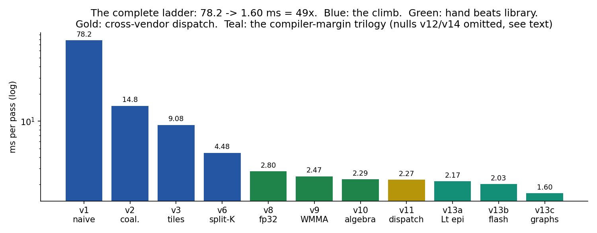
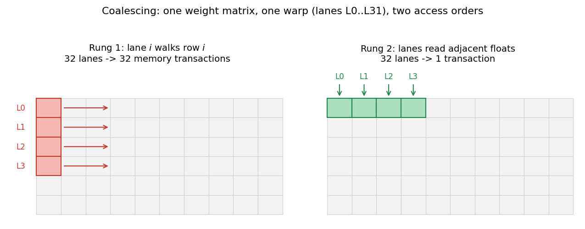
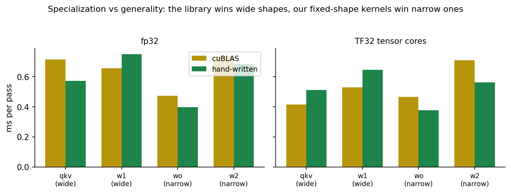
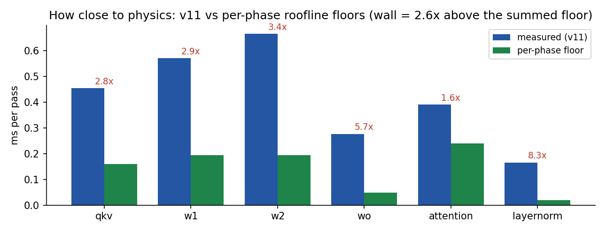
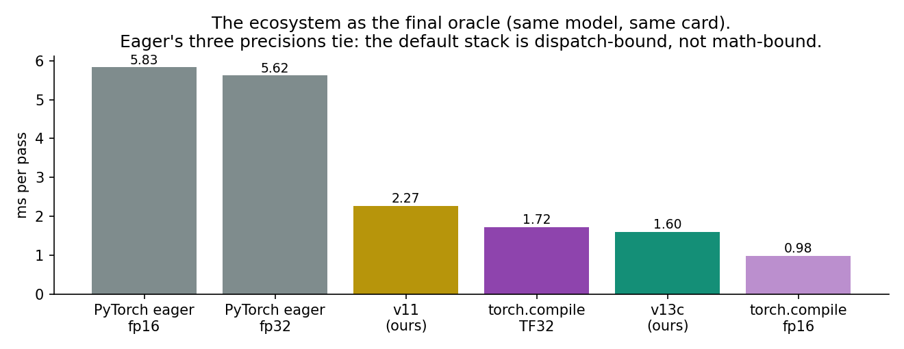
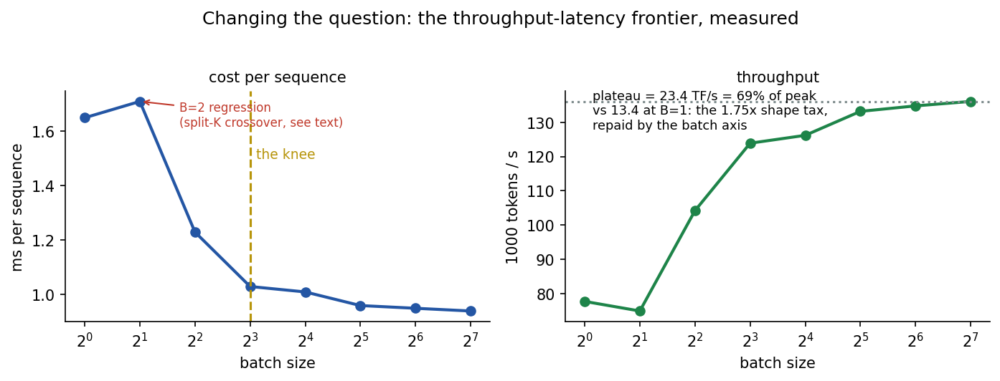
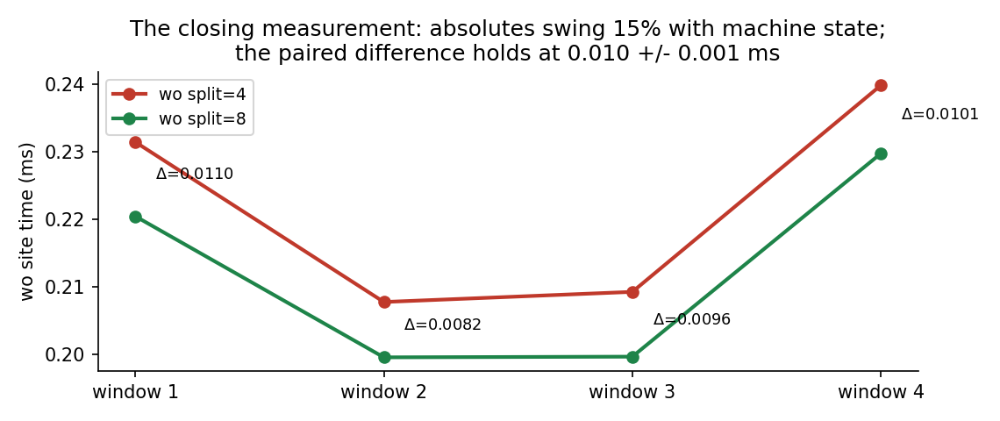

#+TITLE: Optimizing a GPT-2-Class Transformer on a GPU
#+SUBTITLE: Session notes --- GPU microarchitecture, the memory pyramid, and what it actually takes to beat the vendor and the compiler on hardware you own. The sequel to [[file:llm-cpu-optimization.org][the CPU campaign]].
#+DESCRIPTION: Session notes: taking a GPT-2-small-class transformer from a naive CUDA port at 78ms to a tuned hybrid at 1.60ms on an RTX 3080 Ti — past torch.compile — then batching to 136K tokens/s and turning the method itself into a search program.
#+DATE: 2026-08-09
#+FILETAGS: :published:
#+KIND: Notes
#+SUMMARY: From a naive CUDA port to past =torch.compile= — 49× on a 3080\nbsp{}Ti, then 136K tokens/s.
#+AUTHOR: Martin Kristiansen
#+STARTUP: nofold

#+BEGIN_tldr
*Bottom line:* one GPT-2-small-class transformer (85M params, fp32, seq 128) taken from a
naive CUDA port at 78.2ms per forward pass to a tuned hybrid at *1.60ms --- 49× --- on a
single RTX 3080 Ti*, in fifteen explicit steps, ending past =torch.compile='s 1.72ms on the
same workload. Batching then repaid the one factor no kernel could reach, finishing at
*136,000 tokens/second* on a $1,000 consumer card.

- *One layout bit was worth 5.3×.* Storing the weights transposed --- so that consecutive
  threads read consecutive addresses --- was the single largest rung of the entire ladder.
  The same change on the CPU was worth 1.24×.
- *Hand-written kernels beat cuBLAS* --- on the narrow shapes. The library won the wide
  ones. So the fastest binary of the campaign is neither hand-written nor library: it's a
  *measured routing table between them* (2.27ms).
- *The compiler's entire margin was organizational, not kernel-level.* =torch.compile='s
  lead decomposed into three named tricks --- fused epilogues, flash attention, CUDA graph
  capture --- each rebuilt by hand and measured alone. Their sum landed within 0.01ms of the
  predicted margin, and the result passed the compiler.
- *The last 1.75× was never in the code; it was in the question.* A floor analysis split the
  remaining gap into nameable craft and a "shape tax" no implementation escapes at 128 rows.
  Batching repaid the tax at exactly the predicted factor.
- *The method itself became a program:* a discrete search with the campaign's priors
  installed at five distinct ports rediscovered the human-found dispatch table from
  measurements alone --- then named, by regression, the constraint its authors had mispriced
  all along.
#+END_tldr

* Results
:PROPERTIES:
:CUSTOM_ID: results
:NAV: Results
:END:
The [[file:llm-cpu-optimization.org][CPU campaign]] ended with a tiny transformer
certified against the physics of one core. The obvious next question --- the one everybody
asks about five minutes into any performance conversation --- is /what about the GPU?/ So:
same discipline, bigger model (GPT-2-small-class, 85M parameters, 340 MB of fp32 weights,
sequence length 128), and a machine actually worth optimizing for --- an RTX 3080 Ti, which
is 80 streaming multiprocessors, ~34 TF/s of fp32, and 912 GB/s of memory bandwidth, sitting
in a desktop.

The same model in naive single-core C runs at 1,336ms per forward pass. The naive CUDA port
of that exact code is where this ladder starts.

| rung  | change                                                                                                                                      | time             | vs naive port |
|-------+---------------------------------------------------------------------------------------------------------------------------------------------+------------------+---------------|
| —     | [[file:llm-gpu-optimization/files/naive_transformer_bench.c][naive C, one CPU core (i9-10850K)]]                                                                 | 1336 ms          | —             |
| 1     | [[file:llm-gpu-optimization/files/naive_transformer_cuda.cu][naive CUDA port]]                                                                                   | 78.2 ms          | 1.00×         |
| 2     | [[file:llm-gpu-optimization/files/naive_transformer_cuda_v2.cu][coalescing (transposed weights)]]                                                                | 14.77 ms         | 5.3×          |
| 3     | [[file:llm-gpu-optimization/files/naive_transformer_cuda_v3.cu][shared-memory tiling]]                                                                           | 9.08 ms          | 8.6×          |
| 4     | [[file:llm-gpu-optimization/files/naive_transformer_cuda_v4.cu][register tiling + fused qkv]]                                                                    | 7.57 ms          | 10.3×         |
| 5     | [[file:llm-gpu-optimization/files/naive_transformer_cuda_v5.cu][smaller tiles (deliberate falsification)]]                                                       | 8.03 ms          | null          |
| 6     | [[file:llm-gpu-optimization/files/naive_transformer_cuda_v6.cu][split-K on the narrow GEMMs]]                                                                    | 4.48 ms          | 17.5×         |
| —     | /[[file:llm-gpu-optimization/files/naive_transformer_cuda_oracle.cu][oracle: all GEMMs to cuBLAS (fp32 / TF32)]]/                                                | /3.37 / 2.98 ms/ | —             |
| 7     | [[file:llm-gpu-optimization/files/naive_transformer_cuda_v7.cu][parallel attention rebuild]]                                                                     | 2.91 ms          | 26.9×         |
| 8     | [[file:llm-gpu-optimization/files/naive_transformer_cuda_v8.cu][SASS-driven fp32 kernel (beats cuBLAS fp32)]]                                                    | 2.80 ms          | 27.9×         |
| 9     | [[file:llm-gpu-optimization/files/naive_transformer_cuda_v9.cu][hand-built tensor cores, WMMA (beats cuBLAS TF32)]]                                              | 2.47 ms          | 31.7×         |
| 10    | [[file:llm-gpu-optimization/files/naive_transformer_cuda_v10.cu][the CPU campaign's algebra, ported]]                                                            | 2.29 ms          | 34.1×         |
| 11    | [[file:llm-gpu-optimization/files/naive_transformer_cuda_v11.cu][the dispatch table (hand + library, per shape)]]                                                | 2.27 ms          | 34.5×         |
| 12    | [[file:llm-gpu-optimization/files/naive_transformer_cuda_v12.cu][profiler-guided assault on w2]]                                                                 | 2.30 ms          | null          |
| 13a   | [[file:llm-gpu-optimization/files/naive_transformer_cuda_v13a.cu][cuBLASLt fused epilogues]]                                                                     | 2.17 ms          | 36.0×         |
| 13b   | [[file:llm-gpu-optimization/files/naive_transformer_cuda_v13b.cu][hand-built flash attention]]                                                                   | 2.03 ms          | 38.5×         |
| 13c   | [[file:llm-gpu-optimization/files/naive_transformer_cuda_v13c.cu][CUDA graph capture]]                                                                           | *1.60 ms*        | *48.9×*       |
| 14a/b | [[file:llm-gpu-optimization/files/naive_transformer_cuda_v14a.cu][autotuning tournament]] / [[file:llm-gpu-optimization/files/naive_transformer_cuda_v14b.cu][persistent megakernel]] | 1.61 / 1.99 ms   | two nulls     |
| 15    | [[file:llm-gpu-optimization/files/naive_transformer_cuda_v15.cu][batch axis: B sequences per pass]]                                                              | 0.94 ms/seq      | 136K tok/s    |

#+ATTR_HTML: :class chart-caption
The full ladder, re-measured back-to-back in one five-minute window; every historical rung
reproduced within 1%. Each row links to its source --- including the failed experiments,
which are part of the record. Reference points: =torch.compile max-autotune= on the
identical workload = 1.72ms; PyTorch eager = 5.6ms.

#+CAPTION: The complete ladder. Blue: the hand-written climb. Green: hand-written beating the library. Gold: the cross-vendor dispatch champion. Grey: the informative null.
#+ATTR_HTML: :alt The complete optimization ladder from 78.2ms to 1.60ms

Two house rules carried over from the CPU campaign, because they earned it. First, every
version fills its weights from the same seeded random-number generator --- deterministic, so
all nineteen versions compute on bit-identical weights --- and prints its first two output
logits: =0.095916 0.033000=. A timing without that check attached simply does not count as a
result. This sounds bureaucratic until you learn it caught six real bugs across nineteen
versions, every single one /before/ a wrong conclusion got drawn from a fast-but-broken
binary. Second, timings compare only within one measurement window, because the same binary
drifts up to 10% with thermal state, and a comparison across windows is a comparison of
weather.

One law governs everything below. A pass that must execute F floating-point operations and
move B bytes at some level of the memory hierarchy cannot finish faster than max(F/peak,
B/bandwidth) --- the roofline. The interesting part is never the formula; it's which term
binds, because that tells you which currency you're paying in, and an optimization that
saves the /other/ currency is worth exactly nothing. Most of this write-up is the story of
that binding term migrating --- from DRAM transactions to L2 bandwidth to warp count to
issue slots to launch overhead --- until it finally lands somewhere no code can follow.

--------------

* Act I --- The memory game: 78.2 → 4.48ms
:PROPERTIES:
:CUSTOM_ID: memory
:NAV: The memory game
:END:
The naive port is the CPU code transliterated: one thread per output element, each computing
its dot product, ~158 kernel launches per pass. It beats the CPU by 16.9×, which sounds like
success until you ask how a machine with 34 TF/s of compute and 912 GB/s of bandwidth is
spending its time --- and the answer is: on neither. 0.8% of compute peak, 0.5% of useful
bandwidth. When /neither/ roofline term binds, that absence is itself the diagnosis: the
machine is moving roughly 30× more bytes than the algorithm asked for, and the excess is
pure overhead of /how/ we're asking.

Here is the thing to know about GPUs, and it explains most of this act: threads execute in
lock-stepped groups of 32 called warps, and when one warp instruction loads memory, the
hardware merges the 32 addresses into a single transaction --- but only if they're
consecutive. In the naive port, each thread walked its own row of the weight matrix, which
means at every step the warp's 32 addresses sat 3 KB apart. One load became 32 separate
transactions, each delivering 4 useful bytes out of the 128 fetched. The fix is
embarrassing: store the weights transposed. One layout bit. Nothing else changes.

#+CAPTION: Same matrix, same math; the right-hand pattern is one memory transaction per warp instead of thirty-two.
#+ATTR_HTML: :alt Coalesced versus uncoalesced memory access patterns

That one bit is worth *5.3×* --- 78.2 down to 14.77ms --- and it is the largest single rung
of the entire campaign. The comparison worth savoring: the same transposition on the CPU
bought 1.24×. A CPU spends a huge fraction of its silicon on machinery --- out-of-order
execution, prefetchers, deep caches --- whose whole job is forgiving you for bad memory
layouts. The GPU sold all of that machinery and bought lanes with the proceeds. So on a GPU,
layout isn't a tuning parameter. It's the game.

The next two rungs are the same idea told twice, at successive levels of the memory pyramid:
if fetching a value is expensive, arrange to /use it more than once/. Tiling stages 16×16
blocks of the matrices into shared memory --- the fast on-chip scratchpad --- so every
fetched element serves 16 multiply-adds (9.08ms). Register tiling then gives each thread a
4×4 block of accumulators so each shared-memory load serves several of /those/ (7.57ms). If
this pattern sounds familiar from the CPU write-up, it should; the reuse theorem doesn't
care what machine it runs on, only which level of the pyramid currently hurts.

But rung 4's phase profile forked in an interesting way: the wide matrix products got
2.2--2.5× faster while the narrow ones got 15--20% /slower/. Fatter tiles mean fewer blocks,
and the narrow shapes now offered only 48 blocks of work to 80 SMs. Thirty-two processors
sat idle, and no cleverness inside a kernel helps a processor that was never given anything
to do.

The obvious hypothesis --- the narrow shapes need more, smaller blocks --- got its own rung,
and it was /wrong/, usefully. Smaller tiles produced more blocks but fewer warps per block,
and the actual latency-hiding resource (warps in flight) never moved; the version measured
slower (8.03ms). One compile, one dead hypothesis, and the surviving explanation was sharp:
the parallelism the narrow shapes need does not exist in the output plane at all, because
the output plane is fixed. It has to come from the third axis --- the summation.

That's split-K: carve the long reduction axis across independent block-slices, each writing
partial sums, combined by a fixed-order reduction (fixed-order because the logits gate does
not accept "deterministic-ish"). The starved GEMM went from 192 warps in flight to 1,536,
and from the worst per-FLOP shape in the table to the best --- 4.03 down to 1.00ms on that
phase alone, 4.48ms overall. Act I ends with the memory hierarchy pacified and a question
hanging: how good is this, actually?

--------------

* Act II --- Racing the vendor: 4.48 → 2.27ms
:PROPERTIES:
:CUSTOM_ID: vendor
:NAV: Racing the vendor
:END:
Before spending more effort, price the ceiling. Route every matrix product to cuBLAS ---
NVIDIA's own library, decades of engineering, all the tactics --- not as an optimization but
as a /pricing instrument/. Two numbers came back. The library led our hand GEMMs by 1.45×,
which mostly says "keep going, there's headroom." And the tensor cores --- the dedicated
matrix hardware, the thing the marketing slides say is 4× --- bought *1.22×*. Not because
the slides lie, exactly, but because tensor cores raise the /compute/ ceiling, and our
small-batch shapes were nowhere near the old ceiling. Raising a roof nobody is touching buys
very little. This deflation is the roofline doing its job, and it recurs everywhere in
modern inference: the hardware's headline number assumes shapes fat enough to be
compute-bound, and yours mostly aren't.

Meanwhile the phase profiler --- the instrument that picked every rung in this campaign ---
was pointing at attention, which had been quietly running rung-1 code the whole time,
including a softmax whose max and sum were computed by /one thread/ while 100,000 others
waited. Rebuilding it with this act's own toolkit (coalesced warp-per-position score dots,
parallel shuffle-tree reductions) took attention from 0.98 to 0.42ms. 2.91ms, and now the
GEMMs are the biggest phase again --- except this time they're at library speed. To beat the
library, you have to find out what your compiler actually did to you.

So: disassemble the binary and count. The GPU's real machine code is called SASS, and
=cuobjdump= will show it to you, and the count came back damning --- 256 FMA instructions
escorted by 175 integer instructions doing bounds checks and address arithmetic. Nearly half
the issue slots doing bookkeeping instead of math, a bottleneck completely invisible to FLOP
and byte accounting. Three fixes, all at the C++ level: hoist the bounds checks (all real
shapes are exact tile multiples, so the hot path can carry zero predicates), stage in
16-byte =float4= loads, and double-buffer with =cp.async= so the next tile streams in while
the current one computes. The instruction count predicted ~1.5×; the measurement said 1.56×
--- the campaign's best prediction, and worth dwelling on, because across the whole campaign
predictions made from SASS counts went 2-for-2 while predictions made from intuition went
roughly 2-for-11. *The result: 7% faster than cuBLAS fp32, zero library calls.*

The tensor-core version of the same question (rung 9) swaps the register micro-tiles for
warp-level WMMA fragments --- hundreds of FLOPs per issued instruction, the issue-density
war won by hardware --- and lands at parity-plus with cuBLAS-TF32. But look at /where/ each
side wins, because that's the punchline of the whole act:

#+CAPTION: The twin verdicts. The library wins the wide shapes; the hand kernels win the narrow ones. Specialization beats generality at fixed shapes; generality beats specialization everywhere else.
#+ATTR_HTML: :alt Hand-written kernels versus cuBLAS, per GEMM shape

Rung 10 imports the CPU campaign's real lesson: the only optimizations that survive a change
of machine are the ones that are /true/ --- algebra, not scheduling. Layernorm's scale and
shift feed only linear maps, so they fold into adjacent weights offline; bias, relu, and
residual adds move inside the GEMM's store instead of being their own kernels; and since
only the final token's logits are ever read, the last layer runs one row instead of 128 ---
while its keys and values stay full, because attention needs the whole prefix. That
asymmetry, by the way, /is/ the KV cache. Both campaigns now have independently rediscovered
production inference's central data structure by doing dead-code elimination the compiler
can't see. 2.29ms, and --- a nice touch --- the numerical drift /improved/, because folds
computed offline in double precision replaced a runtime fp32 pass.

Which brings us to the champion, and the champion is not a kernel. Nobody wins everywhere:
the library takes the wide shapes, the hand-built split-K tensor-core kernels take the
narrow ones, a dedicated GEMV takes the one-row sites. Route each shape to its measured
winner and you get *2.27ms --- 34.5× within the GPU, 590× the CPU baseline*. The fastest
binary of the campaign is a routing table. If that feels like an anticlimax, consider that
TensorRT and cuDNN are, at enormous scale, exactly this: time the candidates per shape,
cache the winner. Rung 11 is the two-row artisanal version.

One more rung belongs to this act, precisely because it failed. The last expensive phase got
a full profiler-guided assault --- strength-reduced addressing, doubled tile depth, a
three-stage pipeline --- and nothing moved. The clinching detail: a briefly-broken build
that computed NaN through half-staged tiles ran in /exactly the same time/. When a kernel's
duration is invariant to its instruction content, the instructions were never the problem;
the shape itself sets the price, and cuBLAS's version of the same phase (paying the same
toll) confirmed it. Hold that thought --- the campaign eventually sends this tax a bill it
can actually pay. (And yes, the logits gate caught the NaN before any conclusion was drawn.
That's two of the campaign's code-generation bugs caught by the same boring check.)

--------------

* Act III --- Floors, and the ecosystem verdict: 2.27 → 1.60ms
:PROPERTIES:
:CUSTOM_ID: floors
:NAV: Floors
:END:
At this point in any optimization campaign you owe yourself an honest answer to "how much is
left?" --- otherwise you're just polishing indefinitely. Summing per-phase roofline floors
puts the physics of this workload at ~0.87ms against the champion's 2.27, and the 2.6× gap
splits into two substances that deserve different responses. About 1.4× is /craft/, with
named line items: layernorm paying launch latency, attention re-reading K and V, split-K's
partial-sum traffic. Fixable, with known techniques, priced in advance. The remaining
~1.5--1.8× is the /shape tax/ --- at 128 rows, tensor-core tiles run under-filled and
pipelines never reach depth, and rung 12 just demonstrated no kernel escapes it. You exit
that tax only by changing the question. Both halves of this decomposition get tested below,
which is what makes it more than an excuse.

#+CAPTION: The champion against its per-phase floors. Knowing where the boundary between craft and shape lies --- in milliseconds, itemized --- is what a floor is for.
#+ATTR_HTML: :alt v11 measured time against per-phase roofline floors

First, though, the question everyone actually cares about: how does two months of hand-tuned
CUDA stack up against =import torch=? The reference is HuggingFace GPT-2 small ---
architecturally identical to the benchmark --- on the same card. PyTorch eager: 5.6ms, and
here's the beautiful part --- eager fp32, TF32, and fp16 all time /identically/. Read that
again: precision doesn't matter, on a workload that is nominally arithmetic. That's a
controlled experiment proving the default stack is bound by Python dispatch and ~150 unfused
kernel launches, not by math. Then =torch.compile max-autotune=, the ecosystem's best shot:
*1.72ms --- dead center in the band the floor analysis had predicted* for exactly the
features it implements. A floor analysis that forecasts a competitor's result before meeting
it is a floor analysis worth keeping.

#+CAPTION: Six contestants, one workload. At the 2ms scale, the milliseconds live between the kernels, not inside them.
#+ATTR_HTML: :alt Six implementations of the same workload compared

Better still, the compiler showed its work: its autotune logs listed its per-shape kernel
timings, and read closely they said two things. Its Triton-generated GEMMs tied ours. And
its cuBLAS fallback entries were /losing/ the narrow shapes by 1.5× --- the library losing
exactly where our hand kernels had beaten it, independently confirmed by the competition's
own logs. The compiler's entire 0.55ms lead was organizational: /they fused the graph; we
had fused kernels./

So the endgame is attribution: rebuild the compiler's margin one named trick at a time, with
our binary as the control group. Fused epilogues via cuBLASLt --- the bias/relu kernels the
library dispatch had reintroduced disappear again --- 2.17ms. Hand-built flash attention ---
K and V stream through shared memory in tiles serving a whole query block, softmax computed
/online/ with a running max, no score matrix ever touching global memory --- attention 0.40
to 0.25ms, wall 2.03. And CUDA graph capture --- record the pass's ~80 launches once, replay
as a single graph, kernels untouched --- *1.60ms*. That last one was the biggest of the
three, which is its own lesson: the launch tax was ~0.4ms, a fifth of the wall, for /doing
nothing/, twice what theory priced it at.

The accounting at the close is almost suspicious: predicted margin ~0.67ms across three
tricks; banked, 0.09 + 0.14 + 0.43 = 0.66ms. Every individual estimate was wrong ---
epilogues overpriced, graphs underpriced by 2× --- and the sum landed within 0.01ms anyway,
the portfolio redeeming the errors of its parts. *Final standing: 1.60ms, past
torch.compile's 1.72, with every byte still ours.*

Two epilogue experiments both returned null, and both earned their keep. An explicit
16-candidate tournament over cuBLASLt's algorithm choices changed nothing --- the heuristic
was already picking the winner, which is worth knowing. And the persistent megakernel ---
the entire 12-layer pass as /one/ cooperative kernel, ~111 grid-wide syncs, the frontier's
favorite party trick --- lost as forecast (1.99ms), with the interesting number sitting in
the launch banner: 2 blocks per SM instead of 4. A merged kernel runs the /whole pass/ at
its worst phase's register footprint; one kernel means one resource high-water mark. That,
quantified, is why the people who ship megakernels pair them with library-class in-house
GEMMs and per-phase resource budgets, and why you probably shouldn't.

--------------

* Act IV --- Changing the question: 136K tokens/second
:PROPERTIES:
:CUSTOM_ID: batch
:NAV: Batch
:END:
The floor analysis left one factor on the table --- the 1.5--1.8× shape tax --- and named
its own exit: batch. Stack B sequences and every token GEMM runs at 128·B rows while the
weights stream from DRAM /once/ regardless; the under-filled tiles fill. Built on the
champion, with the correctness gate strengthened to match: all B sequences get identical
inputs, so all B outputs must match the reference /and/ each other, bitwise --- any
cross-sequence leak in the batched attention shows up immediately.

#+CAPTION: The measured frontier. Per-sequence cost falls 1.65 → 0.94ms with the knee at B=8; throughput plateaus at 136K tokens/s = 23.4 TF/s, 69% of the card's gated peak sustained across a full transformer.
#+ATTR_HTML: :alt Batch scaling: per-sequence cost and total throughput

The number that closes the campaign: the plateau's 23.4 TF/s over batch-1's 13.4 is *1.75×
--- dead center in the shape-tax band*. Two independent experiments, one subtractive (rung
12 failing to code the tax away) and one additive (batch repaying it), agreeing on the same
number is about as close to proof as performance work gets. And note the quietly absurd
endpoint: at full load, a sequence costs /less/ machine time (0.94ms) than the dedicated
single-sequence champion (1.60ms). The last factor was never in the code. It was in the
question.

--------------

* Act V --- From campaign to program
:PROPERTIES:
:CUSTOM_ID: search
:NAV: The search
:END:
Step back far enough and the whole ladder is a walk through a parameter space --- tile
shapes, pipeline depths, split factors, vendor-or-hand --- plus, above all of that, a
handful of algebraic rewrites. Which invites an uncomfortable question: could a program have
done this? Not by gradient descent --- every variable is discrete, and the landscape is made
of cliffs we personally fell off (occupancy halving at a shared-memory threshold, wave
counts stepping at multiples of 80; a finite-difference gradient on this terrain points at
noise between cliffs). The right frame is an ordinary search loop --- /propose candidates,
predict their cost, pick one, measure it, repeat/ --- and the campaign's actual contribution
is knowing *where in that loop the hard-won knowledge plugs in*. There are four such ports,
plus a fifth left empty on purpose:

#+BEGIN_chart
#+BEGIN_EXPORT html
<svg viewBox="0 0 760 530" role="img" aria-label="The search loop with five ports where prior knowledge installs">
  <defs>
    <marker id="arrow" viewBox="0 0 10 10" refX="9" refY="5" markerWidth="7" markerHeight="7" orient="auto-start-reverse">
      <path d="M 0 0 L 10 5 L 0 10 z" fill="#888888"></path>
    </marker>
  </defs>

  <!-- port annotations (outside the loop) -->
  <text x="70" y="46" font-weight="500">PORT 1 &middot; the space</text>
  <text x="70" y="62">physics as hard constraints;</text>
  <text x="70" y="76">enumerate only the resource knees</text>

  <text x="500" y="46" font-weight="500">PORT 3 &middot; the model</text>
  <text x="500" y="62">the roofline is the guess;</text>
  <text x="500" y="76">a regression learns only its errors</text>

  <text x="500" y="368" font-weight="500">PORT 4 &middot; the choice</text>
  <text x="500" y="384">favor the informative experiment</text>
  <text x="500" y="398">over the merely promising one</text>

  <text x="70" y="368" font-weight="500">PORT 2 &middot; the score</text>
  <text x="70" y="384">distance from the floor, paired,</text>
  <text x="70" y="398">same window; 1.0 means stop</text>

  <!-- injection arrows from annotations into stations -->
  <line x1="150" y1="82" x2="150" y2="106" stroke="#888888" stroke-width="1.2" marker-end="url(#arrow)"></line>
  <line x1="580" y1="82" x2="580" y2="106" stroke="#888888" stroke-width="1.2" marker-end="url(#arrow)"></line>
  <line x1="580" y1="358" x2="580" y2="334" stroke="#888888" stroke-width="1.2" marker-end="url(#arrow)"></line>
  <line x1="150" y1="358" x2="150" y2="334" stroke="#888888" stroke-width="1.2" marker-end="url(#arrow)"></line>

  <!-- the four stations -->
  <rect x="70" y="108" width="200" height="58" fill="none" stroke="#111111" stroke-width="1.4" rx="3"></rect>
  <text x="170" y="133" text-anchor="middle" font-weight="500" fill="#111111">PROPOSE</text>
  <text x="170" y="150" text-anchor="middle">candidate configurations</text>

  <rect x="490" y="108" width="200" height="58" fill="none" stroke="#111111" stroke-width="1.4" rx="3"></rect>
  <text x="590" y="133" text-anchor="middle" font-weight="500" fill="#111111">PREDICT</text>
  <text x="590" y="150" text-anchor="middle">each candidate's cost</text>

  <rect x="490" y="276" width="200" height="58" fill="none" stroke="#111111" stroke-width="1.4" rx="3"></rect>
  <text x="590" y="301" text-anchor="middle" font-weight="500" fill="#111111">PICK</text>
  <text x="590" y="318" text-anchor="middle">the next experiment</text>

  <rect x="70" y="276" width="200" height="58" fill="none" stroke="#111111" stroke-width="1.4" rx="3"></rect>
  <text x="170" y="301" text-anchor="middle" font-weight="500" fill="#111111">MEASURE</text>
  <text x="170" y="318" text-anchor="middle">against the incumbent</text>

  <!-- loop arrows -->
  <line x1="272" y1="137" x2="486" y2="137" stroke="#888888" stroke-width="1.4" marker-end="url(#arrow)"></line>
  <line x1="590" y1="168" x2="590" y2="272" stroke="#888888" stroke-width="1.4" marker-end="url(#arrow)"></line>
  <line x1="488" y1="305" x2="274" y2="305" stroke="#888888" stroke-width="1.4" marker-end="url(#arrow)"></line>
  <line x1="170" y1="274" x2="170" y2="170" stroke="#888888" stroke-width="1.4" marker-end="url(#arrow)"></line>
  <text x="182" y="226">repeat; surprises</text>
  <text x="182" y="240">update the model</text>

  <!-- port 5, outside the loop -->
  <rect x="215" y="428" width="330" height="76" fill="none" stroke="#7a0000" stroke-width="1.4" stroke-dasharray="6 4" rx="3"></rect>
  <text x="380" y="452" text-anchor="middle" font-weight="500" fill="#7a0000">PORT 5 &middot; semantic rewrites (empty)</text>
  <text x="380" y="469" text-anchor="middle">folding, pruning, flash attention &mdash;</text>
  <text x="380" y="486" text-anchor="middle">no sweep can reach what a program means</text>
  <line x1="380" y1="426" x2="380" y2="400" stroke="#7a0000" stroke-width="1.2" stroke-dasharray="6 4"></line>
  <line x1="380" y1="376" x2="380" y2="342" stroke="#7a0000" stroke-width="1.2" stroke-dasharray="6 4"></line>
  <text x="380" y="396" text-anchor="middle" font-size="20" font-weight="500" fill="#7a0000">&#10005;</text>
</svg>
#+END_EXPORT
#+END_chart

#+ATTR_HTML: :class chart-caption
The search loop, and where the campaign's knowledge plugs in. The design rule: install each
prior at a falsifiability level matching your confidence --- laws as constraints,
regularities as generators, beliefs as predictions the measurements can convict. A prior
hard-coded at the wrong tier is how a model becomes confidently, unfalsifiably wrong.

- *Port 1 --- what may be proposed.* Physical laws become hard constraints (shared memory
  budgets, tile divisibility), and the known cliff locations become the menu: instead of
  sweeping every value, enumerate only the resource knees. This is what collapsed a ~10^{12}
  joint space to ~50 candidates per site.
- *Port 3 --- how cost is predicted.* Don't learn a cost model from zero; use the
  roofline-with-penalties model as the default prediction and let a regression on physical
  features (occupancy, waves, tile fill) learn only its /errors/. The payoff: when the
  residual has structure, that structure is a missing constraint with a name.
- *Port 4 --- which experiment to run next.* Prefer candidates the model is uncertain about,
  not just ones it likes --- the falsification habit from rungs 5 and 12, given a formal
  home. Cheap analytic pruning happens before the stopwatch is paid.
- *Port 2 --- how a result is scored.* Not raw milliseconds but distance from the physical
  floor --- comparable across shapes and machines, and it gives the search something no
  raw-time objective has: a stopping rule (efficiency → 1 means done). Candidate and
  incumbent always measured paired, in one window.
- *Port 5 --- left deliberately empty.* No parameter sweep contains layernorm folding or
  flash attention, because those aren't settings --- they're rewrites that change what the
  program /means/. The system marks this port as a hook and searches only the other four.
  That boundary is the experiment: how far do the first four ports get you?

What happened when it ran is the best part of the campaign. In ~40 paired measurements the
search kept the vendor on both wide shapes and went hand-built split-K on the narrow ones
--- rung 11's dispatch structure, re-derived from scratch by a program. Then it convicted
its own w2 pick: the selection rule had compared candidates against a stale incumbent number
from an earlier, warmer window. Measurement was paired; selection was not --- the
same-window doctrine, violated one line after being enforced, caught by the system's own
closing check. At larger budget its table converged to the champion's dispatch /cell for
cell/, and its residual report explained what had slowed it down:
=split, coef −0.14, model OVERprices= --- the hand-set split penalty had made the winning
config look pessimistic. The machine, naming by regression the constraint family its authors
had been mispricing since rung 12. A replication run reproduced the coefficient to the third
digit.

And one last lesson, earned the honest way. The search's one genuinely new finding --- split
factor 8 instead of 4 on the wo GEMM --- was adopted into the champion as a one-constant
change, and the champion did not move. Was the finding even real? The definitive test is a
/paired ablation/: run both configurations side by side, inside the same measurement window,
and look only at the difference. Deliberately, the final chart of this campaign is about the
smallest number in it:

#+CAPTION: The two configurations timed across four measurement windows. The machine's thermal state moves /both/ lines by 15% --- but the gap between them holds at ~0.010ms in every window. When the noise is bigger than the effect, only the within-window difference means anything.
#+ATTR_HTML: :alt Paired ablation: absolute times swing with thermals, the paired difference holds

The corpus eventually grew to ~20 windows, every difference positive, closing the true
effect at 0.009 ± 0.002ms: real, replicated, statistically airtight --- and one-eighth the
size of the story initially told about it. Which is the campaign's closing rule in one line:
direction from the search, magnitude from the pairs, narration from no one.

--------------

* Method --- in six sentences
:PROPERTIES:
:CUSTOM_ID: method
:NAV: Method
:END:
1. *Verify the function before timing it:* the logits gate caught six real bugs across
   nineteen versions --- none by luck, none after a wrong conclusion.
2. *Compare only within one window;* the machine's state is part of every measurement.
3. *Attribute before optimizing:* the phase table chose every rung and finished 7-for-7;
   advance intuition finished roughly 2-for-13 on magnitudes.
4. *Read what the machine actually built* (=cuobjdump=), and when prediction and measurement
   disagree, the disagreement is the next experiment.
5. *Optimizations are reuse schemes climbing one memory pyramid;* mathematics outranks all
   of them; and every fix promotes a new bottleneck --- the campaign ends not when ideas run
   out but when the binding constraint becomes a property of the question rather than the
   code.
6. *When the method becomes a program, it inherits the discipline but not the judgment:* it
   will find true things whose size only the paired ablation can state.

--------------

* Appendix --- discoveries & surprises, ranked
:PROPERTIES:
:CUSTOM_ID: appendix
:NAV: Appendix
:END:
1. *The naive port's diagnosis was that nothing bound.* 0.8% of compute, 0.5% of bandwidth
   --- when neither roofline term is the ceiling, the machine is moving bytes the algorithm
   never asked for. The absence of a bottleneck is itself a bottleneck report.
2. *One layout bit: 5.3× on GPU, 1.24× on CPU.* The cleanest hardware-shapes-software
   measurement of both campaigns. The CPU spends silicon forgiving bad access patterns; the
   GPU spent that silicon on lanes.
3. *Tensor cores bought 1.22×, not 4×.* Headline numbers assume compute-bound shapes; at 128
   rows the workload never touched the old roof. Also, consumer GA102 gates the TF32 rate
   below the datacenter parts' --- measure, never datasheet (the CPU campaign's rule,
   reconfirmed).
4. *A broken kernel timed identically to a correct one* (rung 12) --- the strongest possible
   statement that the shape, not the instruction stream, set the price. The 1.75× batch
   result later confirmed the tax's size independently.
5. *The fastest binary is a routing table.* Hand kernels won narrow shapes, cuBLAS won wide
   ones, symmetrically. Neither side dominating is not a tie --- it's a dispatch
   opportunity.
6. *SASS counting beat intuition 2-for-2 vs 2-for-11.* Issue-slot accounting --- what
   fraction of instructions do mathematics --- is invisible to FLOP and byte counts, and it
   predicted rung 8's 1.56× almost exactly.
7. *torch.compile's margin was zero kernels.* Its Triton kernels tied ours; its entire
   0.55ms lead was graph organization --- and its own autotune logs confirmed our
   hand-beats-library finding on the narrow shapes.
8. *The megakernel's price has a name:* one kernel, one register high-water mark. Merging
   the whole pass halved occupancy because the worst phase's footprint taxed every phase.
9. *Last-token pruning is the KV cache*, rediscovered as dead-code elimination no compiler
   can see --- for the second campaign in a row.
10. *The search convicted its own selection bug* --- comparing against a stale incumbent
    from a warmer window --- with the same closing check that caught the human bugs. The
    discipline transferred; the judgment (sizing the finding) still needed the paired
    ablation.

--------------

* Artifacts
:PROPERTIES:
:CUSTOM_ID: artifacts
:NAV: Artifacts
:END:
#+ATTR_HTML: :class links
[[file:llm-gpu-optimization/files/naive_transformer_bench.c][CPU baseline]]
[[file:llm-gpu-optimization/files/naive_transformer_cuda_oracle.cu][cuBLAS oracle]]
[[file:llm-gpu-optimization/files/v16_kernels.cu][v16_kernels.cu]] [[file:llm-gpu-optimization/files/v16_search.py][v16_search.py]]

The CUDA ladder itself is linked rung by rung from the [[#results][results table]], failed
experiments included. Every file is self-contained: fills identical weights from the same
seeded generator, prints its own logits gate (reference =0.095916 0.033000=). Canonical
build: =nvcc -O3 -arch=sm_86 -DPROFILE=1 file.cu [-lcublas]=. =naive_transformer_bench.c= is
the single-core CPU baseline (1336ms); =_oracle.cu= routes all GEMMs to cuBLAS (=-DTF32= for
tensor cores); =v16_kernels.cu= / =v16_search.py= are the five-port search system.
